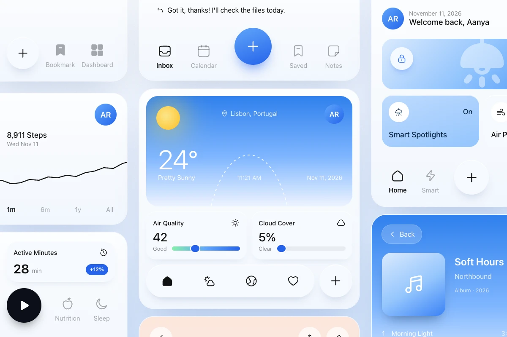

<p align="center">
  
</p>

<h1 align="center">Softstroke</h1>

<p align="center">
  Soft, rounded icons for web and mobile. 310 icons, each in stroke and solid.
</p>

<p align="center">
  <a href="https://sarthak102.github.io/softstroke/"><strong>Browse the icons</strong></a>
  &nbsp;·&nbsp;
  <a href="https://sarthak102.github.io/softstroke/docs/">Docs</a>
  &nbsp;·&nbsp;
  <a href="https://sarthak102.github.io/softstroke/use-cases/">Use cases</a>
</p>

<p align="center">
  
</p>

## What it is

Softstroke is an open-source icon set drawn on a 24px grid with a 1.5px stroke, round caps and squircle corners. Every icon has a solid twin under the same name, so an active state is a one-word import change.

- **Two styles, one name.** `HomeIcon` from `@softstroke/react` is the stroke; from `@softstroke/react/solid` it's the solid.
- **Every major framework.** React, React Native, Vue, Svelte and Angular packages, plain SVG with a sprite, and an icon font.
- **Small.** About 0.4 KB per icon, tree-shakable, no runtime.
- **Accessible by default.** Icons are hidden from screen readers unless you give them a label.
- **MIT licensed.** Free for personal and commercial work.

## Packages

| Package | For |
|---|---|
| `@softstroke/react` | React, Next.js, Vite, Remix |
| `@softstroke/react-native` | React Native, Expo (needs `react-native-svg`) |
| `@softstroke/vue` | Vue 3, Nuxt |
| `@softstroke/svelte` | Svelte 5, SvelteKit |
| `@softstroke/angular` | Angular 17+ (standalone components) |
| `@softstroke/svg` | Plain HTML, any framework: SVG files, a sprite, JSON |
| `@softstroke/font` | One CSS link, no build step: `<i class="ss ss-home">` |

## Quick start

```bash
npm i @softstroke/react
```

```tsx
import { HomeIcon, BellIcon } from '@softstroke/react';
import { HomeIcon as HomeSolidIcon } from '@softstroke/react/solid';

<HomeIcon />                                   // 24px, inherits the text color
<HomeSolidIcon color="#2563eb" />              // the same icon, solid
<BellIcon size={20} strokeWidth={2} aria-label="Notifications" />
```

| Prop | Default | |
|---|---|---|
| `size` | `24` | width and height |
| `color` | `currentColor` (web), `#000` (native) | stroke color (fill color for solid) |
| `strokeWidth` | `1.5` | stroke icons only |

Any other SVG prop (`className`, `style`, `onClick`, ...) is passed through. When an icon is the only content of a button, put the label on the button, or pass `aria-label` to the icon.

<details>
<summary><strong>React Native / Expo</strong></summary>

```bash
npx expo install react-native-svg && npm i @softstroke/react-native
```

```tsx
import { HomeIcon } from '@softstroke/react-native';
// Metro doesn't tree-shake: in big apps, import single icons to keep the bundle small
import CalendarIcon from '@softstroke/react-native/icons/calendar';

<HomeIcon size={24} color="#111" />
```
</details>

<details>
<summary><strong>Vue 3</strong></summary>

```bash
npm i @softstroke/vue
```

```vue
<script setup>
import { HomeIcon } from '@softstroke/vue';
import { HomeIcon as HomeSolidIcon } from '@softstroke/vue/solid';
</script>

<template>
  <HomeIcon :size="24" />
  <HomeSolidIcon color="#2563eb" />
</template>
```
</details>

<details>
<summary><strong>Svelte 5</strong></summary>

```bash
npm i @softstroke/svelte
```

```svelte
<script>
  import { HomeIcon } from '@softstroke/svelte';
  import { HomeIcon as HomeSolidIcon } from '@softstroke/svelte/solid';
</script>

<HomeIcon size={24} />
<HomeSolidIcon color="#2563eb" />
```
</details>

<details>
<summary><strong>Angular</strong></summary>

```bash
npm i @softstroke/angular
```

Every icon is a standalone component: `ss-<name>`, and `ss-<name>-solid` from `@softstroke/angular/solid`.

```ts
import { HomeIcon } from '@softstroke/angular';
import { HomeIcon as HomeSolidIcon } from '@softstroke/angular/solid';

@Component({
  imports: [HomeIcon, HomeSolidIcon],
  template: `<ss-home [size]="24" /> <ss-home-solid color="#2563eb" aria-label="Home" />`,
})
export class Toolbar {}
```
</details>

<details>
<summary><strong>Plain SVG and the icon font</strong></summary>

```html
<svg width="24" height="24"><use href="/sprite.svg#home" /></svg>
```

Single files are in `@softstroke/svg/icons/<name>.svg`, solids in `solid/icons/<name>.svg`.

```html
<link rel="stylesheet" href="https://cdn.jsdelivr.net/npm/@softstroke/font@1/dist/softstroke.css" />

<i class="ss ss-home"></i>        <!-- stroke -->
<i class="ss-solid ss-home"></i>  <!-- solid -->
```

Font icons follow `font-size` and `color`. The stroke width is fixed at 1.5 (a font glyph is a filled outline); use a framework package for other weights.
</details>

## Design notes

- **One drawing grid.** 24px canvas, 2px padding, 1.5px round stroke, squircle corners and softened vertices. Shared shapes come from small geometry helpers in `scripts/geo.py`, so a family (calendar, calendar-plus, calendar-x) reuses the exact same paths.
- **Lint, don't eyeball.** `scripts/lint_joins.py` flags sharp vertices and line ends that stop just short of another stroke; `scripts/bbox.py` checks the live area and centring.
- **Solids are generated, never hand-edited.** `scripts/solids.py` turns each stroke icon into its solid twin (outer edge as the silhouette, details cut at the stroke's own size), and `scripts/lint_solid.py` catches slivers, hairline gaps and tiny islands.
- **One source, many packages.** `scripts/build.mjs` optimises the SVGs with SVGO and writes every package from the same shape list, then `scripts/check.mjs` renders every icon in every framework.
- **The font can't drift.** `font/` is built from the icons in Python and stamped with a hash of its sources; the build fails if an icon changed without rebuilding the font.

## Project structure

```
icons/               Stroke icons, the source of truth (SVG)
icons-solid/         Solid twins, generated by scripts/solids.py
keywords.json        Search words for every icon
categories.json      Category for every icon
font/                Icon font sources (generated, committed)
packages/            One npm package per framework (dist/ is built)
scripts/             Build, checks and the Python drawing tools
web/                 The website (Next.js, static export to GitHub Pages)
brand/               Logo
docs/                Images for this README
```

## Running locally

You need Node 22. The Python tools (solids, font) are only needed when you change icons.

1. Install with `npm install`.
2. Build and check every package with `npm test`.
3. Run the website: `cd web && npm install && npm run dev`.

To draw or change icons, set up the Python tools once:

```bash
python3 -m venv .venv && .venv/bin/pip install -r requirements-dev.txt
```

## Checks

```
npm test                                  Build every package and render every icon
python3 scripts/lint_joins.py             Stroke joins and line ends
python3 scripts/bbox.py <names>           Live area and centring
.venv/bin/python scripts/solids.py        Regenerate icons-solid/
.venv/bin/python scripts/lint_solid.py    Solid slivers, gaps and islands
.venv/bin/python scripts/font.py          Rebuild the icon font
npm run site                              Build the website into web/out
```

## License

MIT, by [Sarthak Kamble](https://github.com/Sarthak102).
